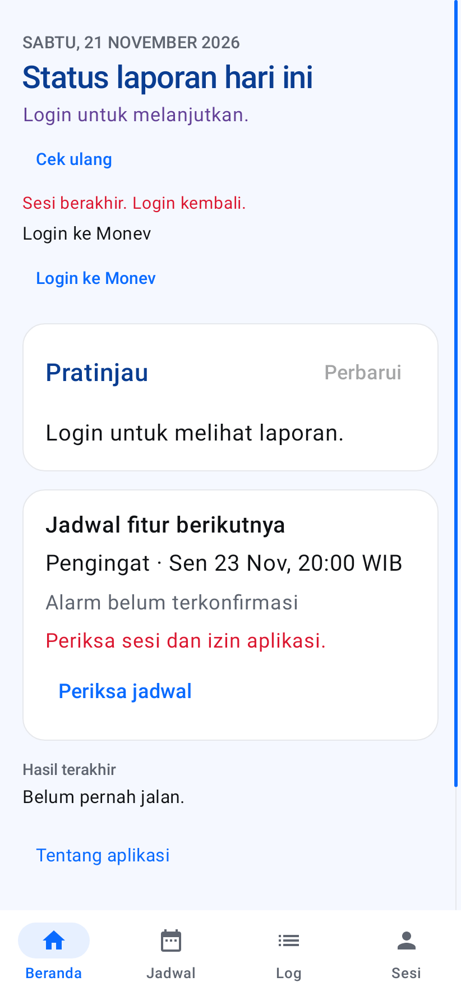
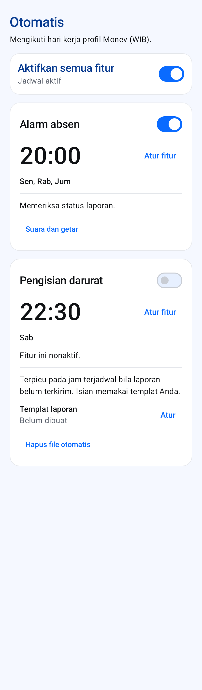

# oh my monev

[](https://github.com/AKARandy/oh-my-monev/actions/workflows/build.yml)
[](https://github.com/AKARandy/oh-my-monev/releases/latest)
[](https://github.com/AKARandy/oh-my-monev/releases)
[-3DDC84?logo=android&logoColor=white)](https://github.com/AKARandy/oh-my-monev/releases/latest)
[](LICENSE)

oh my monev adalah aplikasi Android. Aplikasi ini membantu peserta MagangHub (Kemnaker, Indonesia)
mencatat kehadiran harian di https://monev.maganghub.kemnaker.go.id.

English version: [README.en.md](README.en.md).

[Download stable version here](https://github.com/AKARandy/oh-my-monev/releases/latest) (Untuk user) | [Download dev build version here](https://github.com/AKARandy/oh-my-monev/releases/tag/dev) (Untuk developer jika ingin debugging).

MagangHub memberi uang kepada peserta magang. Tetapi peserta wajib mencatat kehadiran setiap hari.
Jika peserta tidak mengirim catatan sebelum pukul 23.59 WIB, peserta kehilangan uang untuk hari itu.

Oleh karena itu saya mengembangkan aplikasi **oh my monev** ini

Aplikasi ini bisa melakukan hal-hal berikut:

- Aplikasi memberi alarm pada jam yang ditetapkan oleh pengguna jika kehadiran belum tercatat (Defaultnya 20:00).
- Aplikasi dapat mengisi formulir laporan, lalu mengirimnya pada jam yang Anda pilih. Sumber isian
  wajib dipilih satu: templat isi absen buatan Anda, atau lanjutan otomatis dari laporan hari sebelumnya.
- Dimana lanjutan otomatis itu sifatnya MASIH eksperimental dan berisiko. Aplikasi meminta konfirmasi sebelum menyalakannya.
  Aplikasi menyusun ulang kalimat laporan sebelumnya secara offline di perangkat (perlu unduh file bahasa satu kali).
  Makna kalimat dapat berubah. Pratinjau menunjukkan teks yang akan dikirim.
- Aplikasi memeriksa semua teks sebelum mengisi formulir. Setiap bagian wajib berisi 100 sampai 5000 karakter.
- Ponsel boleh dalam keadaan diam dan alarm tetap tepat waktu

Status: rilis stabil v1.1.0 tersedia (build dev terpisah pada tag `dev`).

## Tampilan

| Beranda | Otomatis |
| :---: | :---: |
|  |  |

## Struktur

- `:core`: kode Kotlin tanpa bagian Android. Memeriksa teks, membuat laporan, menghitung waktu.
- `:app`: aplikasi Android. Kode layar, kendali halaman web, alarm.
- `specs/`: spesifikasi formal TLA+ untuk verifikasi mesin status inti.
- `docs/`: rencana kerja. Aturan situs Monev (`monev-logic.md`). Catatan lain.
- `.tools/`: alat bantu build untuk komputer ini. Tidak ada di repositori.

## Build

```powershell
# Langkah 1: Buka folder repositori.
# Langkah 2: Buat local.properties. Tulis jalur SDK di dalamnya.
# Langkah 3: Jalankan perintah ini:
.tools\gradle-8.10.2\bin\gradle.bat :core:test      # mulai dari tes ini. SDK tidak diperlukan.
.tools\gradle-8.10.2\bin\gradle.bat :app:assembleDebug
```

## Penggunaan aplikasi 

Aplikasi memakai akun Anda dan sesi Anda.
Anda bertanggung jawab atas teks yang dikirim aplikasi.
Aplikasi menulis setiap tindakan otomatis ke dalam catatan. Anda dapat membaca teks setiap tindakan.
Anda dapat menghentikan otomatisasi untuk satu hari.
